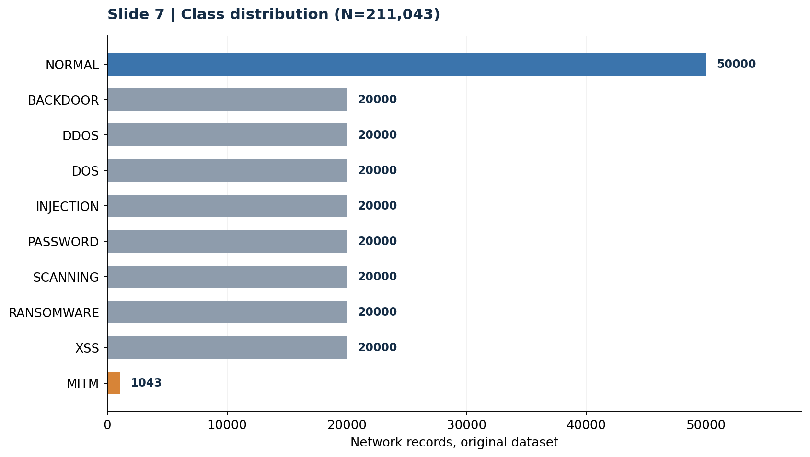
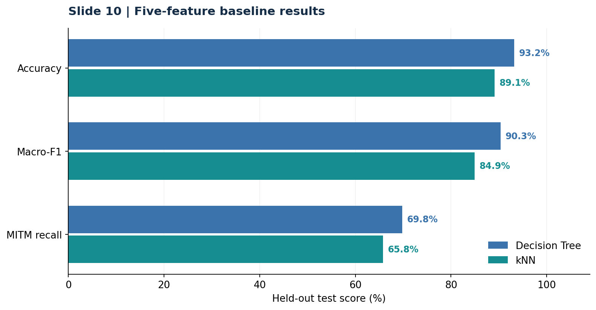

# Feature-Efficient Detection of Difficult IoT Attacks with Classical Machine Learning

**DATA245 | Machine Learning Course Project | Stage 1-3 completed (midterm baseline)**

A reproducible, five-feature intrusion-detection study using the **UNSW ToN-IoT network dataset**, a **Decision Tree**, and **k-Nearest Neighbors (kNN)**. This repository investigates a practical security problem: a classifier can achieve high overall accuracy while still missing certain attack types.

> **Project status:** Dataset audit, EDA, five-feature baselines, classification-error analysis, and repeated-split diagnostics are implemented. Adding `proto` and `conn_state` is **planned future work**, not an evaluated result.
>
> **Important:** This is a course research prototype, **not a production-ready intrusion detection system**. It uses classical machine learning only; no neural networks or neural feature extractors.

## At a glance

| Item | This project |
|---|---|
| Problem | Detect rare and hard-to-classify attacks without relying on overall accuracy alone |
| Dataset | ToN-IoT network traffic; **211,043 observations**, **44 columns**, **10 classes** |
| Inputs to the models | Exactly **5 numerical traffic features** |
| Algorithms | Decision Tree (Gini) and kNN (`k=5`) |
| Experiment design | Exact-row deduplication **before** a group-disjoint train/validation/test split |
| Main metrics | Accuracy, macro-F1, class-wise precision/recall/F1, and prediction time |
| Focus classes | MITM, ransomware, XSS |
| Fixed test results | Decision Tree: **93.2% accuracy**, **69.8% MITM recall**; kNN: **89.1% accuracy**, **65.8% MITM recall** |
| Repeated diagnostic | 10 additional group-disjoint splits to assess **split sensitivity** |
| Next research question | Can 2 more protocol-related fields improve difficult-class recall at acceptable computational cost? |

### Contents

1. [Research motivation and questions](#1-research-motivation-and-questions)
2. [Dataset and the five input features](#2-dataset-and-the-five-input-features)
3. [How the pipeline works](#3-how-the-pipeline-works)
4. [Repository structure](#4-repository-structure)
5. [Set up and run the project](#5-set-up-and-run-the-project)
6. [What each Python script does](#6-what-each-python-script-does)
7. [Results and how to interpret them](#7-results-and-how-to-interpret-them)
8. [Presentation charts and their source code](#8-presentation-charts-and-their-source-code)
9. [Reproducibility and leakage controls](#9-reproducibility-and-leakage-controls)
10. [Limitations and planned work](#10-limitations-and-planned-work)
11. [GitHub collaboration for five members](#11-github-collaboration-for-five-members)
12. [Troubleshooting](#12-troubleshooting)
13. [References and acknowledgments](#13-references-and-acknowledgments)

---

## 1. Research motivation and questions

### Why does this matter?

Network-connected IoT devices (such as sensors, cameras, and smart appliances) communicate continuously. An intrusion detector aims to identify which network records correspond to normal traffic and which are associated with attacks.

**High accuracy is not sufficient by itself.** If a classifier correctly labels most traffic but misses many Man-in-the-Middle (MITM) records, the overall score may hide an important security weakness. We therefore report performance **for each class**, not only one overall number.

### Research questions

**RQ1 - Completed baseline:** How reliably can Decision Tree and kNN classify difficult IoT attacks using only five numerical network-traffic features?

**RQ2 - Planned extension:** Will adding two contextual fields, `proto` (protocol) and `conn_state` (connection state), improve the detection of difficult classes without an unacceptable increase in model complexity or prediction cost?

We are **not proposing a new ML algorithm**. Our contribution is a carefully scoped empirical investigation of feature efficiency, class-wise errors, and sensitivity to how data are split.

### What makes the study different from a simple classification tutorial?

- It evaluates a **10-class network-security problem**, not just attack versus normal.
- It identifies the risk of **rare-class failures** and **repeated feature patterns**.
- It removes exact duplicate rows before splitting and prevents **identical five-feature vectors** from appearing across partitions within one run.
- It separates model training, evaluation, error diagnosis, and repeated-split experiments into independently understandable scripts.
- It records the **source of every numerical chart** shown in the midterm presentation.

---

## 2. Dataset and the five input features

### Dataset origin and scope

We use the **ToN-IoT network dataset** associated with UNSW Canberra. The copy included in this project is:

`data/train_test_network.csv`

| Dataset property | Value |
|---|---:|
| Data records (excluding header) | 211,043 |
| Physical CSV lines (including header) | 211,044 |
| Columns | 44 |
| Classes, including `normal` | 10 |
| Exact duplicated full rows removed | 20,569 |
| Records after deduplication | 190,474 |
| Distinct five-feature patterns after deduplication | 92,347 |

**Important distinction:** The reference article describes a **461,043-record dataset selection**. Our project uses **211,043 records**, so the results should **not** be presented as an exact numerical reproduction of that paper.

### Original class distribution (before removing duplicates)

| Class | Records |
|---|---:|
| Normal | 50,000 |
| Backdoor | 20,000 |
| DDoS | 20,000 |
| DoS | 20,000 |
| Injection | 20,000 |
| Password | 20,000 |
| Scanning | 20,000 |
| Ransomware | 20,000 |
| XSS | 20,000 |
| **MITM** | **1,043** |
| **Total** | **211,043** |

MITM makes up approximately **0.49%** of the original data. However, rarity alone does not prove that MITM is difficult to classify; we must also examine how distinguishable its feature values are.

### Exactly five baseline features

| Feature | Beginner-friendly interpretation |
|---|---|
| `duration` | How long the observed network connection lasted |
| `src_bytes` | Bytes associated with traffic from the source |
| `dst_bytes` | Bytes associated with traffic from the destination |
| `src_ip_bytes` | Source-related IP byte measurement |
| `dst_ip_bytes` | Destination-related IP byte measurement |

**Prediction target:** `type` (10 categories: `normal` and nine attack categories).

The baseline intentionally **does not** use `proto`, `conn_state`, IP addresses, ports, timestamps, the `label` column, neural embeddings, or other target-derived variables as predictors. The purpose is to understand what these **five features alone** can and cannot detect.

### What is feature-pattern diversity?

Two rows have the same *five-feature pattern* when all five selected predictor values are identical. After full-row deduplication:

| Class | Records | Unique five-feature patterns | Unique patterns / records |
|---|---:|---:|---:|
| MITM | 1,041 | 1,007 | 96.7% |
| Ransomware | 14,735 | 251 | 1.7% |
| XSS | 15,137 | 8,589 | 56.7% |

For example, ransomware contains many records but very few **distinct exact five-feature combinations**. This motivates further diagnosis, but it is **not proof** that repeated patterns caused the model errors.

**Caveat:** An exact numeric pattern is **not** the same as an independent attack session. Very small differences in `duration` can create apparently unique patterns.

---

## 3. How the pipeline works

```text
Original CSV (211,043 records)
            |
            v
Stage 1-2: Inspect columns, labels, missing values, class counts
            |
            v
Remove exact full-row duplicates BEFORE splitting (190,474 remain)
            |
            +----> EDA: class balance and five-feature diversity
            |
            v
Group-disjoint train / validation / test split
(identical five-feature patterns stay in one partition)
            |
            v
Stage 3A: Fit preprocessing + Decision Tree / kNN on TRAIN only
            |
            v
Stage 3B: Evaluate saved models on VALIDATION and TEST
            |
            +----> Accuracy, macro-F1, class-wise scores, confusion matrices
            |
            v
Stage 3C: Analyze wrong predictions, including missed MITM attacks

Separate experiment:
Stage 3D: Repeat group-disjoint splitting 10 times,
          refit both models, measure split-to-split variability

Last step: Read saved CSV results and generate presentation charts
```

### Why perform deduplication before splitting?

If identical records appear in both training and testing, test scores can be misleading because the model may encounter effectively the same examples during training. We remove **full-row duplicates first**. Then, we assign all rows with identical five-feature inputs to the **same partition** in each split.

These safeguards prevent certain kinds of **feature-pattern leakage**; they do not by themselves guarantee generalization to new networks or future attacks.

---

## 4. Repository structure

```text
DATA245_IoT_Complete_Modular_Project/
|
|-- README.md                        # This guide
|-- RUN_ORDER.txt                   # Short command checklist
|-- STAGE_1_TO_3_REPORT.md          # Companion research report
|-- requirements.txt                # Python dependencies
|
|-- data/
|   `-- train_test_network.csv      # Original dataset selection
|
|-- src/
|   |-- common.py                   # Shared paths, features, models, split checks
|   |-- 01_eda_preprocessing.py     # Data audit, EDA, duplicate removal, split
|   |-- 02_train_models.py          # Train and save models
|   |-- 03_model_evaluation.py      # Metrics, predictions, confusion matrices
|   |-- 04_classification_errors.py # Where predictions went wrong
|   |-- 05_repeated_split_experiments.py # 10 additional train/test experiments
|   |-- make_presentation_charts.py # Read saved outputs and export charts
|   `-- run_all.py                  # Run the scripts in order
|
|-- results/                        # CSV / JSON outputs from baseline stages
|-- diagnostics/                    # Error analysis and repeated-split outputs
|-- models/                         # Saved .joblib model files
|-- figures/                        # EDA, evaluation and diagnostic plots
|-- presentation_charts/            # Recreated plots + numerical chart tables
|-- presentation/                   # 12-slide midterm .pptx
|-- tests/                          # Saved-output verification script
`-- archive_original_scripts/       # Original combined scripts for traceability
```

**Where to start if you are new:** Read `RUN_ORDER.txt`, then `src/01_eda_preprocessing.py`, and progress through the numbered scripts. Shared settings are in `src/common.py`.

---

## 5. Set up and run the project

### Prerequisites

- **Python:** Python 3.11 or 3.12 is recommended.
- **Terminal:** macOS Terminal, Linux shell, or Windows PowerShell.
- **Git:** Only needed if cloning or contributing through GitHub.
- **Dataset:** `data/train_test_network.csv` must exist when running analysis or training.

Dependencies are listed in `requirements.txt`, including pandas, NumPy, scikit-learn, matplotlib, and joblib. Exact numeric results and timing can vary across library versions and computers.

### Step A - Download or clone

**Option 1: Extract the supplied project ZIP.** Open the extracted folder in Finder.

**Option 2: Clone the team's GitHub repository:**

```bash
git clone https://github.com/OWNER/DATA245-IoT-Attack-Detection.git
cd DATA245-IoT-Attack-Detection
```

Replace `OWNER` with the actual repository owner. **Do not execute `git init` or `git add .` in your Mac home folder (`~`).** Always verify your current directory with `pwd`.

### Step B - Open Terminal in the extracted project folder (macOS)

Type `cd ` (with a space), drag the project folder from Finder into Terminal, and press Return. Then:

```bash
pwd
ls
```

You should see `README.md`, `src`, `results`, and `requirements.txt`.

### Step C - Create a virtual environment and install dependencies

**macOS / Linux:**

```bash
python3 -m venv .venv
source .venv/bin/activate
python -m pip install --upgrade pip
python -m pip install -r requirements.txt
```

**Windows (PowerShell):**

```powershell
py -m venv .venv
.venv\Scripts\Activate.ps1
python -m pip install --upgrade pip
python -m pip install -r requirements.txt
```

A *virtual environment* installs this project's Python packages separately from your system packages. Activate it again whenever you reopen Terminal.

### Step D - Run each stage separately (recommended for learning)

From the **project root**, run in this exact order:

```bash
# Stage 1-2: data audit, EDA, deduplication and fixed split
python src/01_eda_preprocessing.py

# Stage 3A: train both baseline models
python src/02_train_models.py

# Stage 3B: evaluate the saved models
python src/03_model_evaluation.py

# Stage 3C: inspect classification mistakes
python src/04_classification_errors.py

# Stage 3D: optional, more expensive repeated-split experiment
python src/05_repeated_split_experiments.py

# Recreate the charts from already-saved results
python src/make_presentation_charts.py
```

**You do not need to retrain to view existing charts.** The downloaded project already includes saved results. For charts only:

```bash
python src/make_presentation_charts.py
```

### Step E - Run the main stages automatically (optional)

```bash
python src/run_all.py
```

Add the flag below to also rerun the ten additional split experiments:

```bash
python src/run_all.py --include-repeated
```

**Be aware:** Rerunning scripts can overwrite their corresponding saved models, CSV files, and PNG outputs. Keep a copy of the provided baseline results if you plan to experiment with model settings or rebuild the split.

### Step F - Verify the supplied outputs

```bash
python tests/check_saved_outputs.py
```

This script checks the expected dataset shape, deduplicated row count, group-disjoint split, baseline metrics, MITM test counts, 10-split diagnostic records, and presence of the five presentation charts. It checks the **provided project's known outputs**; it is not a comprehensive software test suite.

---

## 6. What each Python script does

Each main experiment lives in a separate file. This makes the workflow easier to debug, explain, and divide among teammates.

| Step | Script | Reads | Main outputs | Does it train an ML model? |
|---|---|---|---|---|
| 1 | `src/01_eda_preprocessing.py` | Raw CSV; optionally saved split file | Data audit, EDA PNGs, feature diversity, split assignments | No |
| 2 | `src/02_train_models.py` | Cleaned data and saved split assignments | `.joblib` models, training times | **Yes** |
| 3 | `src/03_model_evaluation.py` | Saved models and fixed split | Overall/class-wise metrics, predictions, confusion matrices | No |
| 4 | `src/04_classification_errors.py` | Saved actual/predicted labels | Wrong-label counts and MITM error chart | No |
| 5 | `src/05_repeated_split_experiments.py` | Cleaned data | 10-run scores, per-class metrics, stability chart | **Yes: 2 models x 10 splits** |
| 6 | `src/make_presentation_charts.py` | Saved results and diagnostics | Presentation PNGs and chart-data CSVs | No |

### Stage 1-2 - EDA and preprocessing

File: [`src/01_eda_preprocessing.py`](src/01_eda_preprocessing.py)

**EDA** means *Exploratory Data Analysis*: understanding the data before fitting a model. The script checks class counts, missing values, numerical distributions, correlations, duplicate rows, and exact five-feature patterns.

It **reuses** the included fixed train/validation/test assignments by default. The original fixed split came from a seven-fold `StratifiedGroupKFold` procedure: five folds used for training, one for validation, and one for testing. The grouping key is the combination of the five predictors.

You can explicitly create a new split with:

```bash
python src/01_eda_preprocessing.py --rebuild-split
```

**Do not run `--rebuild-split` casually.** It replaces `results/fixed_split_assignments.csv`, so the subsequent metrics may differ. If you rebuild, retrain and evaluate using the new split and label those results as a new run.

### Stage 3A - Model training

File: [`src/02_train_models.py`](src/02_train_models.py)

The **Decision Tree** learns a series of feature-based rules. The model uses the Gini split criterion and a training-only median imputer; the tree is not pruned or tuned in this baseline.

**kNN** classifies a new observation by examining its five nearest neighbors in the training data. The pipeline applies training-only median imputation, `log1p` transformation, standard scaling, and `k=5` with uniform neighbor weights. The code checks that the numerical predictors are nonnegative before applying `log1p`.

Only training examples are used when **fitting** either model or preprocessing step. The models are saved to `models/`.

### Stage 3B - Model evaluation

File: [`src/03_model_evaluation.py`](src/03_model_evaluation.py)

Loads the two previously trained models; it **does not fit them again**. It predicts validation/test labels and calculates:

- **Accuracy:** Fraction of all predictions that are correct.
- **Precision for a class:** Of the records predicted as that class, how many truly belong to it?
- **Recall for a class:** Of the actual records belonging to that class, how many did we detect?
- **F1-score:** A combined score balancing precision and recall.
- **Macro-F1:** Average F1 across all ten classes, giving each class equal weight.
- **Balanced accuracy:** Average recall across classes.
- **Confusion matrix:** A table where rows are *actual* labels and columns are *predicted* labels.
- **Prediction time:** Observed runtime on the machine where evaluation was performed; machine-dependent.

For example, **MITM recall of 69.8%** means the Decision Tree correctly predicted **104 of the 149 actual MITM test records**. It missed 45. It does **not** mean that 69.8% of all traffic was MITM.

Key files: `results/baseline_metrics.csv`, `results/classwise_metrics.csv`, `results/predictions_val_test.csv`, and `results/confusion_*.csv`.

### Stage 3C - Classification error analysis

File: [`src/04_classification_errors.py`](src/04_classification_errors.py)

Instead of training a new model, this script reads **actual versus predicted** labels saved in Stage 3B. It asks: *When a record is misclassified, what wrong class did the model choose?*

For the Decision Tree's 45 missed MITM test records:

| Incorrect prediction | Number of actual MITM records |
|---|---:|
| Normal | 12 |
| Password | 11 |
| DoS | 10 |
| Injection | 5 |
| Other attack categories (combined) | 7 |
| **Total missed** | **45** |

This is more informative than a single MITM recall number. It distinguishes a missed attack classified as normal from an attack confused with a different attack type.

Key files: `diagnostics/original_stage3_mitm_prediction_breakdown.csv`, `diagnostics/all_class_error_breakdown.csv`, and `figures/07_mitm_error_breakdown.png`.

### Stage 3D - Repeated-split experiments

File: [`src/05_repeated_split_experiments.py`](src/05_repeated_split_experiments.py)

A result from one train/test split can depend on which examples happen to fall into the test set. This **separate** experiment measures how scores vary across ten group-disjoint splits.

1. Identify groups of rows sharing the same five predictor values.
2. Use a group's majority class for **stratifying the partition** when a group contains multiple labels. Original row-level labels remain unchanged for model training and evaluation.
3. For each of ten random seeds, split approximately 70%/15%/15% of the **groups** into train/validation/test; row counts can vary.
4. Retrain Decision Tree and kNN, then compute test metrics for each run.
5. Save per-run and per-class scores; summarize mean and range.

The ten seeds are `42, 7, 17, 23, 29, 41, 73, 101, 202, 313`.

For a **single-seed code check** without overwriting the included ten-run diagnostics:

```bash
python src/05_repeated_split_experiments.py --seeds 42 --output-dir tests/one_seed
```

The models are fitted again within each run, but **the runs overlap in observations**. This is **split-sensitivity analysis**, not 10-fold cross-validation, ten independent datasets, or evaluation on a new IoT network.

Key files: `diagnostics/repeated_group_safe_splits.csv`, `diagnostics/repeated_per_class_scores.csv`, `diagnostics/repeat_summary.csv`.

---

## 7. Results and how to interpret them

### Baseline: one fixed held-out test set

Evaluation uses **24,831 test records**, including **149 actual MITM records**.

| Test metric | Decision Tree | kNN |
|---|---:|---:|
| Accuracy | **93.2%** | 89.1% |
| Macro-F1 | **90.3%** | 84.9% |
| MITM precision | **65.8%** | 64.5% |
| MITM recall | **69.8%** | 65.8% |
| MITM F1 | **67.8%** | 65.1% |
| Correct MITM predictions | **104/149** | 98/149 |

**Interpretation:** The Decision Tree has stronger overall metrics on this particular fixed test split, but **both classifiers still miss a substantial fraction of MITM attacks**. For security-relevant evaluation, this distinction matters.

### Model training / evaluation split sizes

| Partition | Records |
|---|---:|
| Train | 140,812 |
| Validation | 24,831 |
| Test | 24,831 |
| **Total after deduplication** | **190,474** |

### Additional 10-split diagnostic

The next values come from the **separate repeated-split analysis**, not the single fixed test set above.

| Class | Decision Tree mean recall | Decision Tree range over 10 runs |
|---|---:|---:|
| MITM | 65.2% | 61.3%-68.6% |
| Ransomware | 32.5% | 4.1%-88.5% |
| XSS | 67.3% | 17.6%-91.2% |
| Injection | 96.2% | 94.8%-96.9% |

**Interpretation:** Certain categories, especially ransomware and XSS, are sensitive to how feature groups are allocated to the different partitions. The large ranges warn against judging model reliability from one favorable split. The diagnostics are exploratory, not proof of poor performance on an independent real-world deployment.

### What has NOT been shown yet

We have **not** evaluated the proposed seven-feature model and have **not** demonstrated that adding `proto` and `conn_state` improves any metric. Results above are exclusively from **five-feature baselines**.

---

## 8. Presentation charts and their source code

A separate script exports **five numerical chart images** for Slides 7, 8, 10, and 11. It reads calculated results from earlier experiments; it does **not** create new ML results.

| Slide | Chart | Data-generation script | Saved numerical source |
|---|---|---|---|
| **7** | Class distribution | `01_eda_preprocessing.py` | `results/class_distribution_original.csv` |
| **8** | Five-feature pattern diversity | `01_eda_preprocessing.py` | `diagnostics/class_pattern_diversity.csv` |
| **10** | Decision Tree vs. kNN comparison | `03_model_evaluation.py` | `results/baseline_metrics.csv` |
| **11, left** | Where missed MITM predictions went | `04_classification_errors.py` | `diagnostics/original_stage3_mitm_prediction_breakdown.csv` |
| **11, right** | Mean recall across repeated splits | `05_repeated_split_experiments.py` | `diagnostics/repeated_per_class_scores.csv` |

All five charts are plotted by [`src/make_presentation_charts.py`](src/make_presentation_charts.py).

**To regenerate all five:**

```bash
python src/make_presentation_charts.py
```

Files appear in `presentation_charts/`, including a matching small `*_data.csv` table for each graph and `chart_provenance.json`, which maps slides to saved source results.

**Chart previews:**





**PowerPoint note:** `presentation/DATA245_IoT_Midterm_12_Slides.pptx` uses separately drawn, editable PowerPoint chart shapes. The exported Python PNGs reproduce **the underlying values**, but not necessarily the exact visual styling of the slides.

---

## 9. Reproducibility and leakage controls

| Practice | How it is addressed |
|---|---|
| Deduplication | Exact **full-row** duplicates are removed **before** splitting |
| Feature-group separation | Identical five-feature patterns cannot cross train/validation/test partitions within one run |
| Preprocessing | Imputation and standardization are fitted as parts of training pipelines |
| Fixed baseline | Supplied split assignments are validated and reused by default |
| Experiment traceability | Per-class metrics, predictions, confusion matrices, and diagnostic CSVs are stored |
| Chart traceability | `chart_provenance.json` and `*_data.csv` files explain numerical charts |
| Repeatability | Ten diagnostic random seeds and a one-seed verification command are documented |

**Why reusing the saved split matters:** If someone changes the train/test partition, they may obtain different scores. This does not necessarily mean the original script was wrong. Always record which split, code version, library versions, and model settings produced reported numbers.

**Reproducibility is not the same as external validity.** Group-disjoint testing prevents identical input patterns crossing partitions. It does not prove that a model will perform equally well on another device, company network, time period, or attack campaign.

---

## 10. Limitations and planned work

### Current limitations

1. **Different dataset selection:** Our 211,043-record CSV differs from the 461,043-record selection described in the reference paper.
2. **Feature-pattern diversity is limited evidence:** Distinct exact values do not guarantee independent attack scenarios; tiny duration differences can inflate uniqueness.
3. **Unresolved label overlap:** Some identical five-feature inputs appear with multiple class labels, so a deterministic classifier cannot disambiguate every such record from those inputs alone.
4. **No external environment test:** We do not claim performance on unseen real IoT networks or future attack campaigns.
5. **Repeated splits reuse observations:** Ranges across seeds describe split sensitivity, not independent confidence intervals.
6. **Exploratory use of test errors:** We inspected the fixed test set for diagnosis. A future final-phase improvement needs a separately planned confirmatory evaluation rather than repeatedly optimizing against the same test labels.
7. **Efficiency varies by hardware:** Measured prediction times depend on device, implementation, data shape, and software version.

### Planned Stage 4 - Targeted feature augmentation

We plan to compare the **current five-feature models** against versions that add exactly two context fields:

- `proto`: protocol information;
- `conn_state`: connection-state information.

The planned comparison will use consistent data splits and appropriate encoding of categorical values, then examine **MITM/ransomware/XSS recall**, macro-F1, precision/false positives, and inference cost. Feature ablation will help determine whether each extra field contributes useful information.

**No seven-feature findings are reported in this repository.** Any future results must be computed and documented before being claimed.

---

## 11. GitHub collaboration for five members

One shared repository is enough. The first upload can contain the full current project; the other members then clone it, review it, and make **genuine improvements** in separate branches. GitHub commits should reflect real work, not artificial changes made only to show activity.

### Repository owner: initial push

From the **project folder**, not from `~`:

```bash
pwd
# Confirm the output is your DATA245 project directory.

git init -b main
git add README.md RUN_ORDER.txt requirements.txt src tests
# Add only other folders/files you intend to publish after reviewing them.
git status
git commit -m "Initial DATA245 project with modular experiments"
```

Create an empty GitHub repository, then connect it:

```bash
git remote add origin https://github.com/OWNER/DATA245-IoT-Attack-Detection.git
git push -u origin main
```

Replace `OWNER` with your GitHub username. If the repository has already been initialized or connected, **do not repeat** the setup commands; use `git status` to inspect your current state.

**Before making a public repository:** Verify the ToN-IoT dataset's redistribution terms and check whether any files contain secrets or personal information. The bundled dataset is approximately 30 MB; GitHub can technically accept it, but sharing a download link and excluding raw data from Git may be preferable depending on the dataset terms and team workflow. Never commit `.venv/`, passwords, API keys, `.env` files, or unnecessary system files.

### Teammates: clone, branch, commit, and request review

After accepting a GitHub collaborator invitation:

```bash
git clone https://github.com/OWNER/DATA245-IoT-Attack-Detection.git
cd DATA245-IoT-Attack-Detection

git switch -c feature/evaluation-tests
# Make and test a meaningful change.

git add src/03_model_evaluation.py tests/
git commit -m "Add evaluation checks"
git push -u origin feature/evaluation-tests
```

Open a **pull request** on GitHub, describe what changed and how it was tested, ask another teammate to review, then merge into `main`. Other teammates follow the same process with distinct branches.

Suggested responsibilities (adjust to match **actual** contributions):

| Workstream | Useful area of the repository |
|---|---|
| Dataset quality and EDA | `src/01_eda_preprocessing.py`, `figures/` |
| Baseline model training | `src/02_train_models.py`, `src/common.py` |
| Evaluation and test coverage | `src/03_model_evaluation.py`, `tests/` |
| Error analysis and interpretation | `src/04_classification_errors.py`, `diagnostics/` |
| Repeated splits, charts, and reporting | `src/05_repeated_split_experiments.py`, `presentation_charts/`, docs |

**Before starting a new branch:**

```bash
git switch main
git pull origin main
git switch -c feature/your-task-name
```

If the project was developed collaboratively before GitHub, list real contributors and responsibilities honestly in the repository description, pull requests, or a `CONTRIBUTORS.md` file. An initial upload by one person does not imply that person authored every file.

---

## 12. Troubleshooting

<details>
<summary><strong>Terminal says "Operation not permitted" on my Mac when I run git add .</strong></summary>

You may be in your home directory rather than the project directory. Run `pwd` and `git rev-parse --show-toplevel`; confirm that both refer to the intended DATA245 project, **not** `/Users/yourname`. Never run `git add .` blindly from your home folder.
</details>

<details>
<summary><strong>python: command not found</strong></summary>

Try `python3 --version` and use `python3` to create the virtual environment. After activating `.venv`, the `python` command should refer to that environment's interpreter.
</details>

<details>
<summary><strong>ModuleNotFoundError: No module named 'pandas' (or sklearn, matplotlib, joblib)</strong></summary>

Activate `.venv`, then run `python -m pip install -r requirements.txt`. Check that installation uses the same Python interpreter as the one executing the scripts.
</details>

<details>
<summary><strong>Missing data/train_test_network.csv</strong></summary>

The analysis requires the original dataset selection at `data/train_test_network.csv`. Confirm the extracted project includes this file. If distributing a code-only GitHub repository, document how teammates obtain this exact dataset selection before running scripts.
</details>

<details>
<summary><strong>Missing fixed_split_assignments.csv or model file</strong></summary>

Run `python src/01_eda_preprocessing.py` before training, then `python src/02_train_models.py` before evaluation. The scripts are deliberately separated by responsibility.
</details>

<details>
<summary><strong>My results do not exactly match the README</strong></summary>

First verify the dataset, split assignments, model configuration, and Python/scikit-learn versions. Running with `--rebuild-split` can change results. Training/prediction timings especially depend on machine hardware.
</details>

<details>
<summary><strong>Why are the PowerPoint bars not identical to the PNG charts?</strong></summary>

The slides were composed with editable PowerPoint objects, while `make_presentation_charts.py` exports independent Matplotlib images. They reflect the same saved numerical results but can differ in fonts, arrangement, and colors.
</details>

<details>
<summary><strong>How do I avoid overwriting the provided repeated-split results?</strong></summary>

Run the one-seed diagnostic to a separate folder: `python src/05_repeated_split_experiments.py --seeds 42 --output-dir tests/one_seed`. Running without `--output-dir` writes into `diagnostics/` and replaces the included diagnostic results.
</details>

---

## 13. References and acknowledgments

### Research foundation

Dharini, N., Janani, V. S., & Katiravan, J. (2026). *Efficient detection of intrusions in TON-IoT dataset using hybrid feature selection approach*. **Scientific Reports, 16**, Article 7763. https://doi.org/10.1038/s41598-026-37834-y

### Dataset

UNSW Canberra. *ToN-IoT Datasets*. https://research.unsw.edu.au/projects/toniot-datasets

### Project artifacts

- Full methods and baseline details: [`STAGE_1_TO_3_REPORT.md`](STAGE_1_TO_3_REPORT.md)
- Additional difficult-class analysis: [`diagnostics/DIAGNOSTIC_REPORT.md`](diagnostics/DIAGNOSTIC_REPORT.md)
- Presentation chart provenance: [`presentation_charts/chart_provenance.json`](presentation_charts/chart_provenance.json)
- Original combined Python scripts for audit: [`archive_original_scripts/`](archive_original_scripts/)

**Team:** DATA245 course project group (five members). Add actual member names, GitHub handles, and contributions here after agreement among the team. Do not infer individual authorship from the order in which code was uploaded.

---

*Last revised: October 2026. All numerical findings above refer to the included five-feature baseline and saved diagnostics unless clearly marked as future work.*
